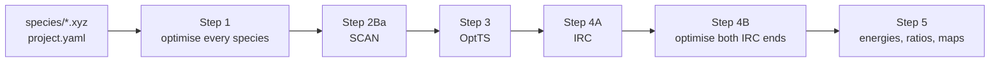

# mechflow

**mechflow** runs the [ORCA Mechanism Procedure](https://geoffreyweal.github.io/ORCA_Mechanism_Procedure/)
for every step of a reaction network at once, from transition-state search to energies.

You give it two things:

1. **A folder of xyz files**, one per species: reactants, intermediates, products and catalysts.
2. **One `project.yaml` file.** It says which steps connect the species, which two atoms to SCAN for each step,
   and which mechanisms (paths through the steps) you want to compare.

mechflow then writes every ORCA input and Slurm script, reads each output, and runs the procedure's checks.
When a stage passes, it writes the input for the next stage. At the end it collects the Gibbs energies into
energy profiles and product ratios, and draws network maps of the mechanisms.



## What mechflow does for you

| stage | mechflow |
|---|---|
| Step 1 | writes an optimisation (OPT FREQ) for every xyz file in `species/` |
| Step 2Ba | when the start structure has optimised, writes a relaxed SCAN of the step's two atoms in 0.02 Å steps |
| Step 3 | picks the highest point of the SCAN and writes the OptTS input |
| Step 4A | checks that the TS has exactly one imaginary frequency, then writes the IRC |
| Step 4B | optimises both IRC end points and checks that they are the two sides of the step |
| Step 5 | Gibbs energy profiles of every mechanism, barriers, and predicted product ratios |
| maps | network maps (Graphviz and Mermaid), optionally coloured by progress |

It never submits anything unless you ask it to: `mechflow submit` submits the prepared jobs
(`mechflow submit --dry-run` lists them first).

## Names

| IDs | what |
|---|---|
| **R1, R2, …** | reactants |
| **I1, I2, …** | intermediates |
| **P1, P2, …** | products |
| **C1, C2, …** | catalysts and other species used during the reaction (e.g. an acid and its conjugate base) |
| **S1, S2, …** | steps, one transition-state search each |
| **TS1, TS2, …** | transition states: step **Sn** goes through **TSn** |
| **M1, M2, …** | mechanisms (paths from the reactants to a product) |

Letters after the number are allowed. When a reaction can give two isomers, P1a and P1b can be the two
products, I2a and I2b the same intermediate on the two branches, and S1a / S1b (TS1a / TS1b) the same step on
each branch.

## A typical session

```bash
mechflow init          # project.yaml for the xyz files in species/
#   ... add the steps and mechanisms to project.yaml ...
mechflow validate      # checks everything, writes overview.md
mechflow next          # writes every input that can be written now
mechflow submit        # submits every prepared job
#   ... jobs finish ...
mechflow next          # checks the finished stages, writes the next inputs
mechflow submit
#   ... repeat until 'mechflow status' says DONE ...
mechflow collect       # energies, profiles, product ratios -> results/
mechflow map --status  # network map -> maps/
```

## Where next

- [Installation](installation.md)
- [Quick start](quick_start.md): the whole procedure on HCN → HNC, small enough for a laptop
- [Species](species.md), [steps](steps.md) and [mechanisms](mechanisms.md): setting up your own reaction
- [The workflow stages](workflow.md): what `mechflow next` checks at each stage
- [Energies and selectivity](energies.md): barriers and product ratios from the finished calculations
