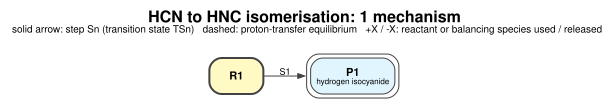
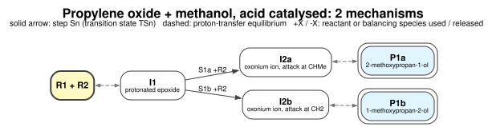
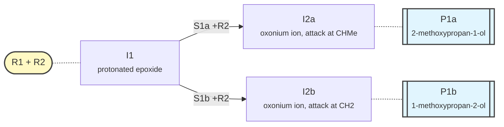

# Network maps

`mechflow map` draws the mechanisms of a project as one network:

- **boxes** are the species a mechanism passes through. The start (the reactants) is yellow, and products
  have a double border;
- **solid arrows** are steps, labelled with the step ID (step Sn goes through TSn);
- **dashed lines** are proton-transfer equilibria (two species written next to each other in a path);
- **+X / −X** on an arrow: a reactant or balancing species that the step uses or releases and that is not
  shown in the boxes, e.g. `S1a +R2` (methanol adds) or `S3 -P2` (water leaves).

Unreacted reactants and balancing species (water, acid, base) are left out of the boxes.

```console
$ mechflow map
network: 6 nodes, 5 connections -> maps/network.dot, maps/network.md, maps/network.svg, maps/network.pdf
```

| file | what |
|---|---|
| `maps/network.dot` | Graphviz source |
| `maps/network.svg`, `.pdf`, `.png` | images (needs Graphviz; see [Installation](installation.md#graphviz-optional-for-map-images)) |
| `maps/network.md`, `.mmd` | Mermaid version, shown directly by GitHub, VS Code and this website |

## Options

| option | what |
|---|---|
| `--by-product` | one map per product (e.g. all mechanisms to P1a, all to P1b) |
| `--mech M1A,M7` / `--product P1a` | only these mechanisms |
| `--status` | colour by progress: green done, orange CHECK, blue running or submitted, grey not run yet, red needs attention |
| `--energies` | Gibbs energies (relative to the start) on the boxes and on the steps' arrows, where known |
| `--colour-mechanisms` | steps used by only one mechanism get that mechanism's colour |
| `--direction TB` | top to bottom |
| `--no-names` | IDs only |

`mechflow map --status --by-product` is a quick way to see how far a large project has got.

## Examples

HCN → HNC:



The acid-catalysed opening of propylene oxide by methanol from the [Mechanisms](mechanisms.md) page, with its
two products:



The same map in Mermaid, as written to `maps/network.md` (Mermaid maps show directly on GitHub, in VS Code and
on pages like this one):


