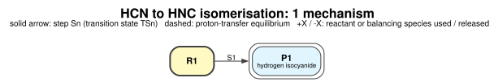

# Quick start: HCN → HNC

This example runs the whole procedure on the smallest reaction there is: hydrogen cyanide turning into
hydrogen isocyanide by a 1,2-hydrogen shift. It has two species and one step, and every job takes seconds,
so it is a good test of your ORCA set-up and of mechflow itself.

The files are in [`examples/HCN_isomerisation`](https://github.com/geoffreyweal/ORCA_Mechanism_Workflow/tree/main/examples/HCN_isomerisation).

## 1. The species

One xyz file per species. The file name is the species ID, and the comment line (line 2) gives the charge
and multiplicity:

=== "species/R1.xyz"

    ```
    3
    R1 hydrogen cyanide (slightly bent so the SCAN can leave the straight line)  charge=0 mult=1
    C     0.00000000    0.00000000    0.00000000
    N     1.15300000    0.00000000    0.00000000
    H    -1.04980000    0.18510000    0.00000000
    ```

=== "species/P1.xyz"

    ```
    3
    P1 hydrogen isocyanide  charge=0 mult=1
    C     0.00000000    0.00000000    0.00000000
    N     1.16900000    0.00000000    0.00000000
    H     2.16300000    0.02000000    0.00000000
    ```

## 2. project.yaml

```yaml
project:
  name: HCN
  title: HCN to HNC isomerisation
  atom_numbering: 0          # atoms counted from 0, as in ORCA inputs

orca:                        # only what differs from the defaults
  method: "!B3LYP DEF2-SVP D3BJ"
  solvent_block: ""          # gas phase

resources:
  nprocs: 4
  maxcore: 1000

slurm:
  time: "0-02:00"
  mem_per_cpu: 1000MB

species:
  R1: hydrogen cyanide
  P1: hydrogen isocyanide

steps:
  S1:
    name: 1,2-hydrogen shift from C to N
    reaction: R1 -> P1
    scan: {from: R1, atoms: [2, 1], to: 1.00}    # H2 ... N1, brought together

mechanisms:
  M1:
    name: 1,2-hydrogen shift
    path: [R1, S1, P1]

energies:
  reference: R1
```

The step S1 says: start from the optimised structure of R1, and SCAN the distance between atom 2 (H) and
atom 1 (N) from its current value (2.21 Å) down to 1.00 Å. The H is not bonded to the N at the start, so the
SCAN brings the two atoms together.

## 3. Check it

```console
$ mechflow validate
2 species, 1 step, 1 mechanism (3 states, all balanced against R1).
Wrote overview.md
No problems found.
```

`overview.md` lists the species, the steps (with the SCAN distance measured in the xyz file) and the
mechanisms.

## 4. Step 1: optimise the species

```console
$ mechflow next
R1      Step 1 input written
P1      Step 1 input written

Prepared 2 species and 0 step stage(s). Next: mechflow submit
$ mechflow submit
Wrote submit_ready.sh with 2 job(s). Submit them with:  bash submit_ready.sh
$ bash submit_ready.sh
```

!!! tip "No Slurm?"
    `mechflow submit --local` writes `run_ready.sh` instead. It runs the jobs one after the other on your
    own computer, as long as `orca` is on your `PATH`.

`calcs/Species/R1/Step1_Geo_Opt/` now holds `orca.inp`, `submit.sl` and `start_structure.xyz`, laid out
exactly like the procedure's templates.

## 5. Repeat `next` → `submit`

Each time jobs finish, run `mechflow next` again. It checks the finished stage and writes the next one:

```console
$ mechflow next
S1      SCAN H2-N1: 2.211 -> 0.991 A in 62 points
...
$ mechflow next
S1      OptTS from SCAN image 37 (d = 1.491 A)
...
$ mechflow next
S1      IRC from the optimised TS1
...
$ mechflow next
S1      Forwards and Backwards optimisations from the IRC end points
```

`mechflow status` shows where everything is up to:

```console
$ mechflow status
SPECIES (Step 1 optimisation)
  R1      ok         hydrogen cyanide
  P1      ok         hydrogen isocyanide

STEPS (SCAN -> OptTS -> IRC -> Forwards/Backwards)
  S1      DONE     H2-N1 bonded Forwards (0.99 A), not Backwards (2.21 A); connects R1 (Backwards) and P1 (Forwards)
```

DONE means that the TS has one imaginary frequency, both IRC ends optimised to minima, and the two ends
are R1 and P1.

## 6. Energies and a map

```console
$ mechflow collect
| mechanism | product | highest TS | G(highest TS) | ...
| M1        | P1      | TS1        | ...
$ mechflow map --status --energies
network: 2 nodes, 1 connections -> maps/network.dot, maps/network.md, maps/network.svg, maps/network.pdf
```



The numbers in this page's outputs (image numbers, distances) are examples; yours depend on ORCA.
