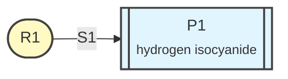

# HCN to HNC isomerisation

Project `HCN`: 2 species, 1 step (one TS search each), 1 mechanism.

- Method: `!B3LYP DEF2-SVP D3BJ`
- Solvent: `none`
- Atom numbers below count from 0 (as in ORCA inputs).
- Names: R reactants, I intermediates, P products, C catalysts / species used during the reaction, S steps; step Sn goes through transition state TSn.
- Energy reference (G = 0): R1; states are balanced with R1.

## Species

| ID | role | name | formula | charge | mult | atoms | used by |
|---|---|---|---|---|---|---|---|
| R1 | reactant | hydrogen cyanide | CHN | 0 | 1 | 3 | 1 mechanism, S1 |
| P1 | product | hydrogen isocyanide | CHN | 0 | 1 | 3 | 1 mechanism, S1 |

## Steps

SCAN: the distance between two atoms of the `from` structure is scanned from its value there (measured in the species xyz file below; re-measured after Step 1) to `to`.

| step | TS | what happens | reaction | SCAN | used by |
|---|---|---|---|---|---|
| S1 | TS1 | 1,2-hydrogen shift from C to N | R1 -> P1 | from R1: H2–N1 2.21 → 1.00 Å (together) | M1 |

## Mechanisms

—Sn→ is a step (transition state TSn); ⇌ is a proton-transfer equilibrium. Unreacted reactants and balancing species are not shown.

- **M1** 1,2-hydrogen shift (product **P1**)  
  R1 —S1→ **P1**

## Network map

